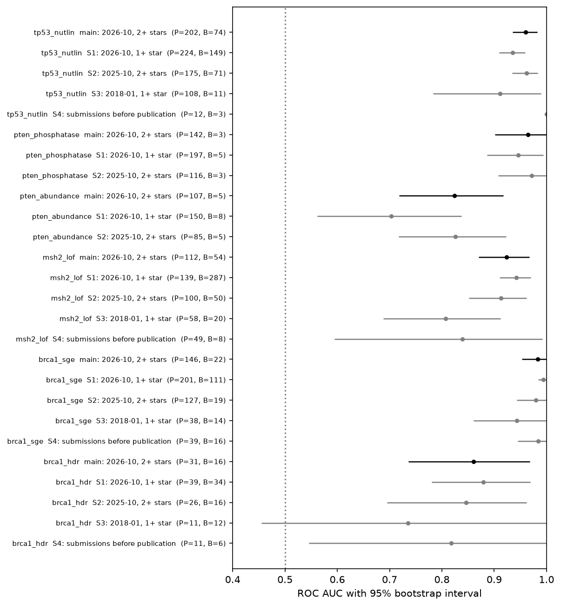

# mavecal

How well do six published multiplexed assays of variant effect separate disease-causing from
harmless missense variants in BRCA1, TP53, PTEN and MSH2, and how much clinical evidence would
their readouts be worth under ClinGen's OddsPath method? This repository answers that with
public data, a Snakemake workflow and an analysis plan committed before the first result. It is research software;
nothing here classifies a patient's variant.

## The question in plain terms

Genetic testing finds many variants that change one amino acid. For most of them nobody knows
whether they cause disease; the lab reports them as variants of uncertain significance (VUS).
A multiplexed assay of variant effect (MAVE) measures, in cells, what thousands of such
variants do to a protein's function. If an assay's "broken" and "working" calls agree with
variants whose effect is already known, its calls can count as evidence for the unknown ones.

An assay score measures function in a lab system. It is not a probability of disease, and a
good match to known variants does not show that the assay models the disease mechanism. ClinGen
asks for that judgement separately (Brnich et al. 2019); this repository does not make it.

The known variants come from ClinVar, which collects classifications from clinical labs and
expert panels. One trap: some of those classifications already used the same assay data, which
makes the assay look better than it is. Two of the four sensitivity analyses address this.

## What was found

ClinVar release 2026-10, missense variants with 2 or more review stars. P and B are the numbers
of pathogenic and benign controls. OddsPath and evidence strength come from cross-fitted
thresholds; the strength quoted is the one the conservative end of the 95% interval supports.

| score set | P | B | ROC AUC (95% CI) | abnormal readout | normal readout |
|---|---|---|---|---|---|
| BRCA1 saturation genome editing | 146 | 22 | 0.983 (0.953 to 1.000) | PS3_moderate | BS3 |
| BRCA1 HDR reporter | 31 | 16 | 0.861 (0.736 to 0.968) | PS3_supporting | BS3_supporting |
| TP53 nutlin-3 growth | 202 | 74 | 0.960 (0.935 to 0.982) | PS3_moderate | BS3_moderate |
| PTEN lipid phosphatase | 142 | 3 | 0.965 (3 benign, interval not quoted) | not estimated | not estimated |
| PTEN abundance (VAMP-seq) | 107 | 5 | 0.824 (5 benign, interval not quoted) | not quoted, 5 benign | not quoted, 5 benign |
| MSH2 6-thioguanine resistance | 112 | 54 | 0.924 (0.871 to 0.967) | PS3_moderate | BS3_moderate |

- Measured against these ClinVar controls, BRCA1 SGE, TP53 and MSH2 reach moderate evidence
  or better for both readouts, and BRCA1 HDR supporting-level evidence. Whether an assay
  models the disease mechanism, which ClinGen also requires, is not judged here. The PTEN
  score sets are not calibrated: ClinVar gives them only 3 and 5 benign missense controls.
- Against the ClinVar release of January 2018, which predates all six assay papers, the point
  AUC is lower for every score set that can still be scored, but every 2018 interval overlaps
  the main one: BRCA1 SGE 0.983 to 0.944 (0.86 to 1.00), BRCA1 HDR 0.861 to 0.735 (0.45 to
  1.00, which includes 0.5), TP53 0.960 to 0.912 (0.78 to 0.99), MSH2 0.924 to 0.807 (0.69 to
  0.91). Rebuilding labels from submissions made before each paper (S4) shows no drop for BRCA1
  SGE (0.984) and a drop for MSH2 (0.839, 8 benign controls). Neither check separates
  circularity from the smaller, older label sets, which also include 1-star records.



ROC AUC with its 95% bootstrap interval for every score set and analysis: the main analysis in
black, sensitivity analyses S1 to S4 in grey, with the pathogenic and benign control counts on
each row. This is `results/figures/auc_forest.png` as the committed run wrote it. The figure
draws the computed interval on every row; the tables quote none where a class has fewer than 10 controls,
such as the PTEN rows, because a bootstrap from 3 to 8 controls says little.

The full results, with intervals, are in [docs/report.md](docs/report.md).

## Running it

Python 3.13, the only version CI tests (Ubuntu). Ubuntu 24.04 ships Python 3.12, which pip
rejects (`requires-python >=3.13`), so install 3.13 first. On Python 3.14, pip builds one
Snakemake dependency, `immutables`, from source and needs a C compiler. The workflow reads four ClinVar files from three monthly releases (1.25 GB) and downloads
six MaveDB score sets (8 MB) through the MaveDB API.
The wheel and source archive that the release workflow builds hold the `mavecal` Python package
and its tests only; the workflow, config and analysis plan run from a clone.

```console
$ git clone https://github.com/Daneshpajouh/mavecal.git
$ cd mavecal
$ python3.13 -m venv .venv && .venv/bin/pip install -e ".[dev]"
$ make test           # 90 tests on synthetic data, about 35 s (about a minute on the first run)
$ make rule-tests     # 8 Snakemake rule tests
```

For the real analysis, put the ClinVar files listed in [docs/data_sources.md](docs/data_sources.md)
under `<data_dir>/clinvar_releases/` and point the workflow at that directory:

```console
$ export MAVECAL_DATA_DIR=/path/to/data
$ .venv/bin/snakemake --profile profiles/local
...
79 of 79 steps (100%) done
$ .venv/bin/snakemake --report results/snakemake_report.html
```

`results/run/manifest_end.json` records Snakemake's last progress line as
`"steps": {"done": ..., "total": ...}`. The 79 above is from the 1.0.0 run, before that field
existed. The committed results come from a rerun with `--forcerun filter_clinvar` at commit
8262a14 that reused the six MaveDB downloads. Its manifest records 73 of 73 steps (79 less the
six `fetch_mavedb` jobs) and mavecal 1.0.0, because the version became 2.0.0 after that run.

`data_dir` can also be set with `--config data_dir=/path`, or `data` in the repository root can be
a symlink to it. `MAVECAL_DATA_DIR`, when set, wins over both. On a Slurm cluster use
`--profile profiles/slurm` after setting the account and partition in that file. The
container image passed the tests and the offline workflow run (docs/testing.md); the real
analysis was run in the virtual environment, not in the container. To run it there:

```console
$ docker build -t mavecal:2.0.0 .
$ docker run --rm -e MAVECAL_DATA_DIR=/data -v /path/to/data:/data \
    -v "$PWD/results:/opt/mavecal/results" mavecal:2.0.0
```

The release workflow publishes the same image as `ghcr.io/daneshpajouh/mavecal:2.0.0`
after running the test suite inside it.

The release workflow does not build the Snakemake HTML report: the report needs the full run and
its ClinVar data, which CI does not have. After a run, `make report` writes
`results/snakemake_report.html`, and it is uploaded to the release by hand. The 2.0.0 release
carries it as `mavecal-2.0.0-snakemake_report.html`.

```console
$ make report
$ cp results/snakemake_report.html mavecal-2.0.0-snakemake_report.html
$ gh release upload v2.0.0 mavecal-2.0.0-snakemake_report.html
```

## Layout

```
config/          config.yaml, scoresets.tsv (validated by workflow/schemas)
workflow/        Snakefile, rules/, scripts/, envs/, schemas/, report/ captions
profiles/        local and slurm Snakemake profiles
src/mavecal/     the statistics, ClinVar and MaveDB parsing, and plotting
tests/           pytest suite and synthetic test data
.tests/          Snakemake integration config and generated rule tests
results/         tables, figures, matched controls and run manifests from the 2026-10-19 run
                 (the Snakemake HTML report is not kept in git; it is uploaded to each release
                 by hand, see Running it)
docs/            analysis plan, report, methods, validation, limitations, data sources,
                 testing and logging notes
```

## Documents

- [docs/analysis_plan.md](docs/analysis_plan.md): the plan, committed before any score was
  joined to a label (commit 61bc081).
- [docs/report.md](docs/report.md): results and their context in published MAVE calibrations.
- [docs/slides/slides.html](docs/slides/slides.html): ten slides for a non-specialist audience;
  opens offline, rebuilt by `docs/slides/build_slides.py`.
- [docs/methods.md](docs/methods.md), [docs/validation.md](docs/validation.md),
  [docs/limitations.md](docs/limitations.md), [docs/data_sources.md](docs/data_sources.md),
  [docs/testing.md](docs/testing.md), [docs/logging.md](docs/logging.md).

## Licence and citation

Code: Apache-2.0. MaveDB score sets used here are CC0; ClinVar data are public and carry
NCBI's terms (see docs/data_sources.md). Cite with [CITATION.cff](CITATION.cff).
